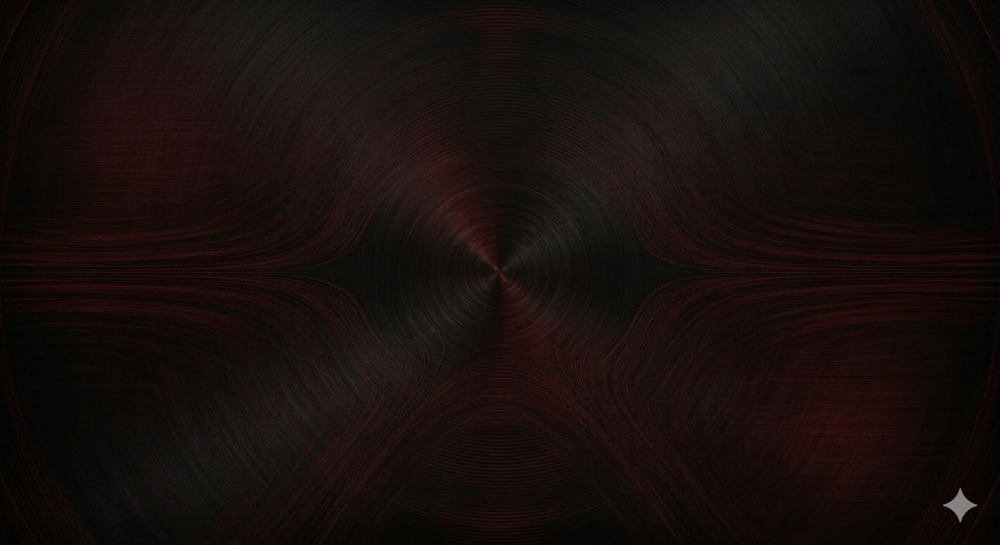

<p align="center">
  
</p>

<h1 align="center">SimpleDynamicEQ</h1>
<p align="center">
  <b>Equalizador paramétrico dinâmico profissional de 24 bandas com Analyzer FFT e Mid/Side</b><br/>
  Compatível com <b>Qualquer DAW no Windows e macOS</b> · Feito com JUCE &amp; C++17
</p>

<p align="center">
  <a href="https://github.com/Adoregabriel2005/SimpleDynamicEQ/releases/latest">
    
  </a>
  
  
  
</p>

---

## Compatibilidade Universal com DAWs

SimpleDynamicEQ é compilado como binário nativo universal para **Windows** e **macOS** (Intel x86_64 e Apple Silicon arm64 M1/M2/M3/M4), suportando canais **Mono** e **Stereo**:

| DAW | Sistema Operacional | Formato Utilizado |
|---|---|---|
| **Apple Logic Pro** | macOS | **AU (AudioUnit .component)** |
| **GarageBand** | macOS | **AU (AudioUnit .component)** |
| **FL Studio** | Windows / macOS | **VST3 / AU** |
| **Ableton Live** | Windows / macOS | **VST3 / AU** |
| **Reaper** | Windows / macOS / Linux | **VST3 / AU** |
| **Cubase / Nuendo** | Windows / macOS | **VST3** |
| **Studio One** | Windows / macOS | **VST3 / AU** |
| **Bitwig Studio** | Windows / macOS / Linux | **VST3** |
| **Cakewalk / Waveform** | Windows / macOS | **VST3** |
| **Sem DAW (App)** | Windows / macOS | **Standalone (.exe / .app)** |

---

## Funcionalidades

| Feature | Detalhe |
|---|---|
| **24 bandas simultâneas** | Cada banda com parâmetros independentes e controles precisos |
| **Tipos de filtro** | Bell, Low/High Shelf, Low/High Cut (até 48 dB/oct Butterworth), Notch, Band Pass, All Pass |
| **Dynamic EQ** | Threshold, Dynamic Range, Attack e Release por banda com redução visual dinâmica |
| **Mid/Side & Stereo** | Tratamento independente de canais Stereo, Mid, Side, Left ou Right (e Mono nativo) |
| **3 modos de fase** | Zero Latency (IIR), Natural Phase, Linear Phase (FIR 4096 taps com compensação automática) |
| **Modelos analógicos** | Clean (digital puro), SSL, Neve, Pultec, API, Sontec |
| **Analyzer FFT** | Espectro em tempo real de alta precisão com suporte a pré/pós EQ |
| **Detector de problemas** | Alertas visuais automáticos de ressonâncias acumuladas e clipping |
| **12 presets boom-bap / mix** | Categorias prontas para voz, kick, snare, bass, master e instrumentos |
| **Faixa de ganho ±30 dB** | Resolução floating-point 64-bit para máxima fidelidade |
| **File Player (Standalone)** | Player de áudio integrado com loop e play/pause para audição e calibração rápida |

---

## Como Instalar

### 1. Windows (VST3 & Standalone)

1. Baixe o pacote Windows em [**Releases**](https://github.com/Adoregabriel2005/SimpleDynamicEQ/releases).
2. Copie `SimpleDynamicEQ.vst3` para a pasta padrão de plugins do Windows:
   ```text
   C:\Program Files\Common Files\VST3\
   ```
3. Abra sua DAW (FL Studio, Ableton, Reaper, etc.) e faça a busca/scan de plugins.

### 2. macOS (Logic Pro, GarageBand, Ableton, FL Studio, Reaper)

1. Baixe o pacote macOS Universal em [**Releases**](https://github.com/Adoregabriel2005/SimpleDynamicEQ/releases).
2. Copie os formatos desejados para as pastas do seu Mac:
   - **Para Logic Pro / GarageBand (AU):**
     ```text
     ~/Library/Audio/Plug-Ins/Components/SimpleDynamicEQ.component
     ```
   - **Para Ableton, FL Studio, Reaper, Cubase (VST3):**
     ```text
     ~/Library/Audio/Plug-Ins/VST3/SimpleDynamicEQ.vst3
     ```
3. Abra sua DAW e o plugin será carregado nativamente tanto em Macs Intel quanto Apple Silicon (M1/M2/M3/M4)!

---

## Compilar do Código-Fonte

### Compilação no Windows
Utilize o script automatizado PowerShell ou CMake:
```powershell
.\build.ps1 -Config Release
```
O script compilará o plugin e o instalará diretamente em `C:\Program Files\Common Files\VST3\`.

### Compilação no macOS / Linux
Abra o terminal no diretório do projeto e execute:
```bash
chmod +x build.sh
./build.sh Release
```
O script gerará binários universais (`arm64` + `x86_64`), compilará os formatos VST3, AU e Standalone, e instalará automaticamente nas pastas do macOS.

---

## Controles e Atalhos

| Ação | Resultado |
|---|---|
| **Arrastar bolinha** | Altera Frequência (X) e Ganho (Y) |
| **Scroll do mouse na bolinha** | Altera a largura de banda (Q) |
| **Alt + Scroll na bolinha** | Ajusta a faixa dinâmica do Dynamic EQ |
| **Duplo clique na bolinha** | Reseta o ganho para 0 dB |
| **Clique direito na bolinha** | Menu de contexto: Solo, Tornar Dinâmico, Deletar Banda |
| **Botões 1–24** | Seleciona a banda para edição detalhada no painel inferior |

---

## Licença

Este projeto é de código aberto sob a licença **GPLv3**.

<p align="center">
  Desenvolvido por <b>GoriSound</b>
</p>
